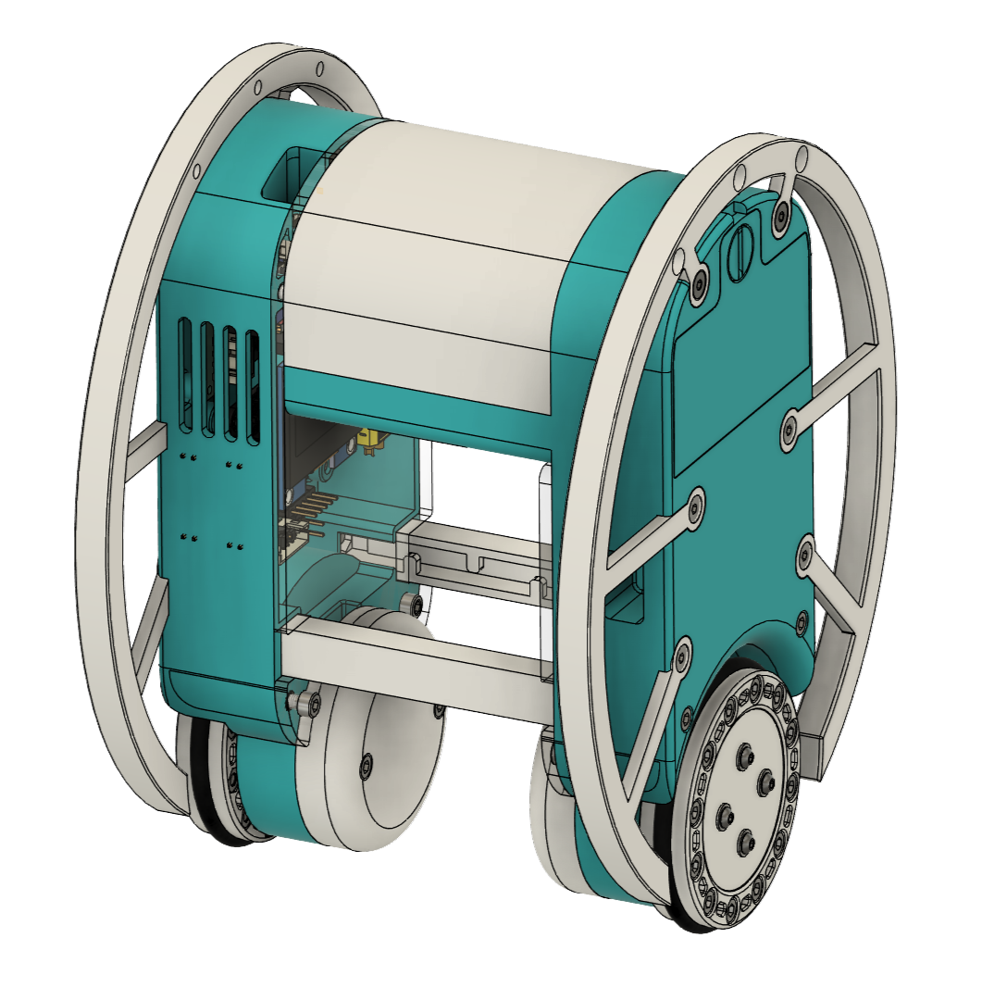
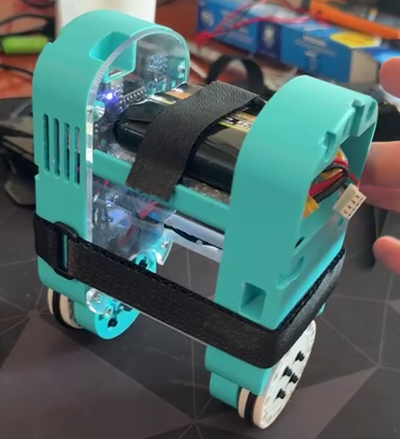

# EBS-SBR

A compact two-wheeled **self-balancing robot** with custom electronics: an ESP32-S3 controller board running an LQR balance loop, and two STM32G431 field-oriented-control (FOC) BLDC driver boards talking to it over CAN.

<p align="center">
  
  
</p>
<p align="center"><em>CAD render (left) and the assembled robot (right)</em></p>

## Architecture

```
            ┌──────────────────────────────┐
            │      Controller Board        │
            │  ESP32-S3 (Waveshare Zero)   │
            │  BMI160 IMU · LQR · WS2812   │
            └──────────────┬───────────────┘
                           │ CAN 2.0B @ 1 Mbit/s
             ┌─────────────┴─────────────┐
   ┌─────────┴─────────┐       ┌─────────┴─────────┐
   │ Driver Board (L)  │       │ Driver Board (R)  │
   │ STM32G431CBU6     │       │ STM32G431CBU6     │
   │ DRV8316 · AS5048A │       │ DRV8316 · AS5048A │
   └─────────┬─────────┘       └─────────┬─────────┘
          BLDC motor                  BLDC motor
```

### Controller Board (`firmware/Controller-Board`)

- **MCU:** Waveshare ESP32-S3 Zero (Arduino framework via pioarduino)
- **IMU:** Bosch BMI160 over SPI, fused with a complementary filter (Madgwick AHRS also included)
- **Control:** full-state LQR (wheel displacement, tilt, yaw and their rates) running as FreeRTOS tasks
- **Comms:** CAN via [ACAN-ESP32FD](https://github.com/clawntl/ACAN-ESP32FD), status WS2812 LED, button and buzzer
- Default rates: IMU at 500 Hz, motor commands at 500 Hz

### Driver Board (`firmware/Driver-Board`)

The motor drivers are the [**BLDC-Driver**](https://github.com/clawntl/BLDC-Driver) board, a compact 39 mm × 36 mm FOC driver. Its KiCad hardware, full documentation and the latest firmware live in that repo; `firmware/Driver-Board` here is the version used on this robot.

- **MCU:** STM32G431CBU6 with hardware CORDIC acceleration
- **Power stage:** TI DRV8316 with integrated FETs (6-PWM), low-side current sensing on all three phases
- **Encoder:** AS5048A magnetic sensor over SPI
- **Control:** [SimpleFOC](https://simplefoc.com/) current (torque) control, 11 pole-pair motors on a 12 V supply
- **Comms:** FDCAN (classic CAN 2.0B, 1 Mbit/s), receiving target currents and broadcasting shaft velocity every 10 ms
- **Flashing:** USB DFU (hold the DFU button, or trigger it over serial)

See the BLDC-Driver [hardware guide](https://github.com/clawntl/BLDC-Driver/blob/main/docs/hardware.md), [firmware guide](https://github.com/clawntl/BLDC-Driver/blob/main/docs/firmware.md) and [CAN protocol](https://github.com/clawntl/BLDC-Driver/blob/main/docs/can-protocol.md) for details.

## CAN protocol

| ID      | Direction             | Purpose                         |
|---------|-----------------------|---------------------------------|
| `0x020` | Controller → both     | Broadcast to both motor drivers |
| `0x021` | Controller → left     | Left motor driver               |
| `0x022` | Controller → right    | Right motor driver              |
| `0x100` | Right driver → ctrl   | Right shaft velocity            |
| `0x101` | Left driver → ctrl    | Left shaft velocity             |

Command bytes: `0x02` shaft velocity, `0x10` start FOC, `0xFF` error.

## Building and flashing

Both firmware projects use [PlatformIO](https://platformio.org/).

**Controller board:**

```bash
cd firmware/Controller-Board
pio run -t upload
```

**Driver boards:** the `left` and `right` environments set which motor the firmware is built for (CAN address and velocity ID).

```bash
cd firmware/Driver-Board
pio run -e left -t upload
pio run -e right -t upload
```

## Tuning over serial

The controller board accepts commands at 115200 baud, one per line:

| Command      | Effect                                           |
|--------------|--------------------------------------------------|
| `SP <deg>`   | Balance angle set point (degrees from upright)   |
| `DA <deg>`   | Tilt angle at which the motors are deactivated   |
| `K0 <value>` | Wheel displacement gain                          |
| `K1 <value>` | Tilt angle gain                                  |
| `K3 <value>` | Wheel velocity gain                              |
| `K4 <value>` | Tilt velocity gain                               |
| `CA <value>` | Complementary filter coefficient                 |

Default gains live in [`firmware/Controller-Board/src/RobotParams.cpp`](firmware/Controller-Board/src/RobotParams.cpp).

## Repository layout

```
docs/        Documentation
firmware/    Controller-Board (ESP32-S3) and Driver-Board (STM32G431) PlatformIO projects
hardware/    CAD and controller PCB design files (driver PCB: see BLDC-Driver)
images/      Renders and photos
```

## License

[GNU AGPL-3.0](LICENSE)
