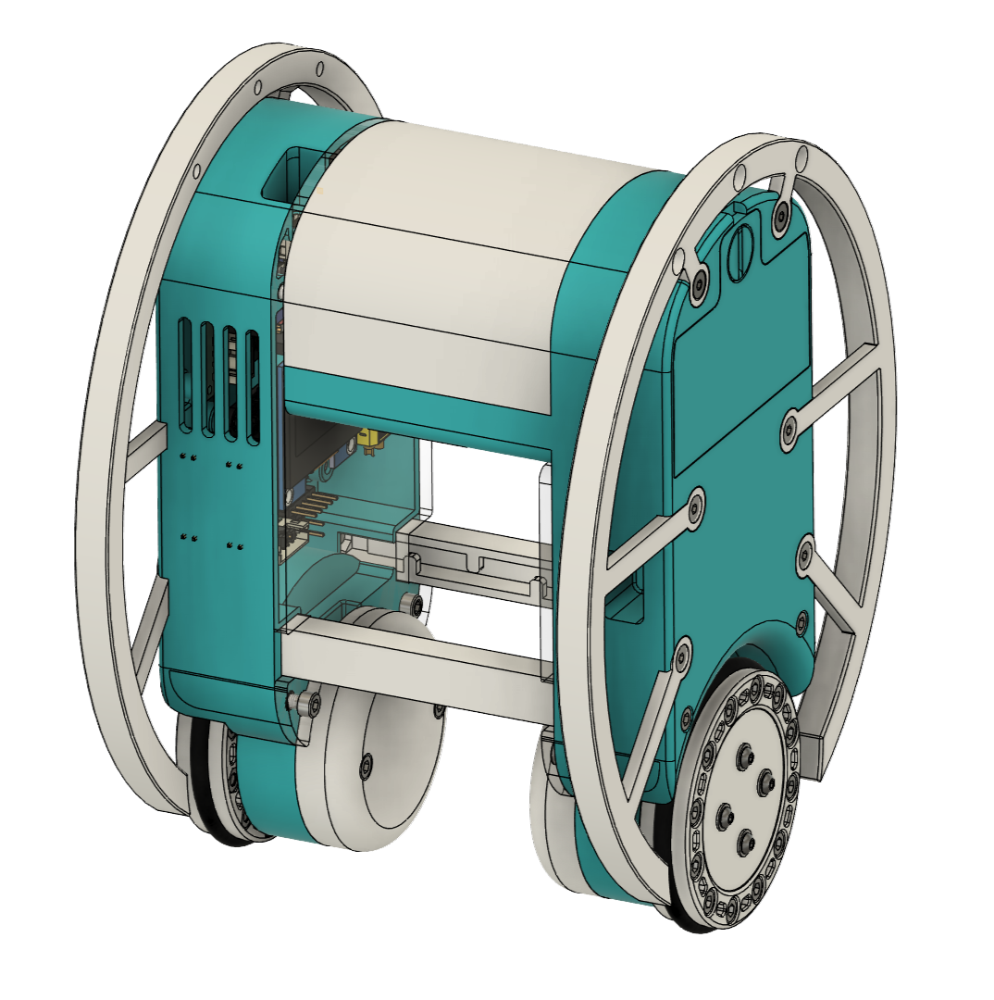
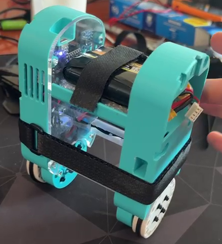

# EBS-SBR

A compact two-wheeled **self-balancing robot** with custom electronics: an ESP32-S3 controller board running an LQR balance loop, and two STM32G431 field-oriented-control (FOC) BLDC driver boards talking to it over CAN.

<p align="center">
  
  
</p>
<p align="center"><em>CAD render (left) and the assembled robot (right)</em></p>

## Architecture

```
            ┌──────────────────────────────┐
            │      Controller Board        │
            │  ESP32-S3 (Waveshare Zero)   │
            │  BMI160 IMU · LQR · OLED     │
            └──────────────┬───────────────┘
                           │ CAN 2.0B @ 1 Mbit/s
             ┌─────────────┴─────────────┐
   ┌─────────┴─────────┐       ┌─────────┴─────────┐
   │ Driver Board (L)  │       │ Driver Board (R)  │
   │ STM32G431CBU6     │       │ STM32G431CBU6     │
   │ DRV8316 · AS5048A │       │ DRV8316 · AS5048A │
   └─────────┬─────────┘       └─────────┬─────────┘
          BLDC motor                  BLDC motor
```

### Controller Board (`firmware/`)

- **MCU:** Waveshare ESP32-S3 Zero (Arduino framework via pioarduino)
- **IMU:** Bosch BMI160 over SPI, fused with a complementary filter (Madgwick AHRS also included)
- **Control:** full-state LQR (wheel displacement, tilt, yaw and their rates) running as FreeRTOS tasks. The LQR runs once per IMU sample and sends the motor currents straight away.
- **Motor driver supervision:** tracks each driver's heartbeat, starts FOC on the drivers one at a time, retries failed starts and restarts a driver that resets. The motors are only driven when both drivers are running.
- **Comms:** CAN via [ACAN-ESP32FD](https://github.com/clawntl/ACAN-ESP32FD), Wi-Fi web interface, status WS2812 LED, button and buzzer
- **Display:** optional 128×64 SSD1306/SSD1315 OLED (I²C, 0x3C) showing balance state, tilt, motor currents, driver status and faults
- Default rate: IMU and control loop at 500 Hz (motor currents are sent once per sample)

### Driver Boards

The motor drivers are the [**BLDC-Driver**](https://github.com/clawntl/BLDC-Driver) board, a compact 39 mm × 36 mm FOC driver. Its KiCad hardware, firmware and full documentation live in that repo.

> **Note:** this controller firmware needs BLDC-Driver firmware 1.2 or later (CAN node IDs, `CMD_DRIVER_STATUS` heartbeat). Drivers running older firmware are never started. With firmware 1.3 or later, the web page also shows each driver's board model (e.g. "BLDC-Driver v0.2"), read with `CMD_GET_BOARD_INFO`.

- **MCU:** STM32G431CBU6 with hardware CORDIC acceleration
- **Power stage:** TI DRV8316 with integrated FETs (6-PWM), low-side current sensing on all three phases
- **Encoder:** AS5048A magnetic sensor over SPI
- **Control:** [SimpleFOC](https://simplefoc.com/) current (torque) control, 11 pole-pair motors on a 12 V supply
- **Comms:** FDCAN (classic CAN 2.0B, 1 Mbit/s), receiving target currents, sending shaft velocity every 10 ms and a status heartbeat every 100 ms
- **Setup:** one firmware build for both sides. Each board's CAN node ID (node 1 = left, node 2 = right by default) and direction invert are set over USB serial or CAN and saved to flash.
- **Flashing:** USB DFU (hold BOOT and press RST, press the USER button, or type `dfu` in the serial console)

See the BLDC-Driver [board page](https://github.com/clawntl/BLDC-Driver/blob/main/docs/boards/bldc_driver_v02.md), [firmware guide](https://github.com/clawntl/BLDC-Driver/blob/main/docs/firmware.md) and [CAN protocol](https://github.com/clawntl/BLDC-Driver/blob/main/docs/can-protocol.md) for details.

## CAN protocol

Each driver has a CAN node ID *n* (1–15). This robot uses node 1 for the left wheel and node 2 for the right; the `leftNode` / `rightNode` settings change that.

| ID | Direction | Purpose |
|---|---|---|
| `0x010 + (n-1)/2` | Controller → drivers | Target currents: two floats, odd nodes bytes 0–3, even nodes bytes 4–7. Nodes 1 and 2 share `0x010` |
| `0x020 + n` | Controller → driver *n* | Start FOC and configuration commands (`0x021` left, `0x022` right) |
| `0x100 + n` | Driver *n* → controller | Velocity, status heartbeat (incl. supply voltage), replies and errors (`0x101` left, `0x102` right) |

Command bytes: `0x02` shaft velocity, `0x03` driver status heartbeat, `0x10` start FOC (and the driver's reply), `0x20`–`0x27` configuration and board information, `0xFF` error. See the BLDC-Driver [CAN protocol](https://github.com/clawntl/BLDC-Driver/blob/main/docs/can-protocol.md) for the frame layouts.

## Building and flashing

Both firmware projects use [PlatformIO](https://platformio.org/).

**Controller board:** the web page (`firmware/data/index.html`) is compiled into the firmware by `firmware/scripts/embed_web.py`, so there is no separate filesystem upload.

```bash
cd firmware
pio run -t upload
```

Once the robot is running this firmware and has joined the same network as your computer (Access point only turned off on the WiFi tab), it can also be flashed over WiFi:

```bash
pio run -e ota -t upload --upload-port balancebot-xxxxxx.local
```

The firmware uses the `min_spiffs.csv` partition table (two ~1.9 MB app slots for OTA). Moving to it from the old `default.csv` layout needs one USB flash; saved settings (NVS) survive the change.

**Driver boards:** build and flash from the BLDC-Driver repo. All boards use the same build. Each board is then given its node ID over its USB serial console:

```bash
cd Firmware          # in the BLDC-Driver repo
pio run -e bldc_driver_v02 -t upload
```

```text
set node 1           # 1 = left, 2 = right (or: set side left / right)
set invert on|off    # optional
save
```

Settings survive reflashing, so a board that is already set up keeps its node ID. They can also be changed from this controller's web page or with BLDC-Driver's [CAN test tools](https://github.com/clawntl/BLDC-Driver/blob/main/docs/can-tools.md).

See the BLDC-Driver [firmware guide](https://github.com/clawntl/BLDC-Driver/blob/main/docs/firmware.md) for details.

## Web interface

The controller runs a Wi-Fi access point:

- **SSID:** `BalanceBot-xxxxxx`
- **Password:** `balancebot-xxxxxx`

where `xxxxxx` is the last three bytes of the board's soft-AP MAC address in lower-case hex, so every robot has its own network. Both are printed on the serial console at boot, along with a `WIFI:...` string that can be pasted into a QR code generator to make a scan-to-join code.

To make a printable scan-to-join sign (PNG) and a bare QR code (SVG) for a robot, pass its suffix to the helper script:

```
python3 -m venv .venv
source .venv/bin/activate                 # Windows: .venv\Scripts\activate
pip install "qrcode[pil]"
python tools/wifi_qr.py 5302cc            # or several: 5302cc a1b2c3 ...
```

The files are written to `tools/qr-codes/` (git-ignored, as they contain the robot's password); use `--out DIR` to put them elsewhere.

Joining the network opens the web page automatically on most phones (captive portal); otherwise browse to `http://192.168.71.1/`. (The address isn't the ESP32 default 192.168.4.1, because some home routers use that range.) The page updates live over a WebSocket and has five tabs:

- **Tune:** live state, tilt, set point, wheel speed, loop rate, both motor drivers' state and the battery level; a battery chart (average of the two drivers' readings, optionally each driver's) and a telemetry chart (tilt, LQR and motor currents, tilt rate, wheel speed) over 10 s to 1 h; every tunable setting, with an explanation for each, and **Save to flash / Revert to saved / Factory defaults**; and **Record**, which captures every control step (5-60 s, now or when it next starts balancing) for download as CSV, with the settings in use in its header.
- **Control:** the touch joystick and gamepad selection, Pause, and a live status readout. The browser's Gamepad API needs Chrome or Edge here: Firefox only allows it on HTTPS pages.
- **WiFi:** the **Access point only** switch (on by default, for open days), saved networks (up to 5), a scan of networks in range, and the connection status. With Access point only off, the robot joins the strongest saved network at power-on and falls back to its own access point when none is available. On a home network it's at `http://balancebot-xxxxxx.local/`.
- **Log:** recent messages from the robot (start-up, motor drivers, IMU, WiFi, battery), with their uptime.
- **Info:** the robot's name, WiFi password and addresses, the motor drivers' details, and how to use it.

Drive input is zeroed if the page stops sending for 300 ms, and straight away if the page disconnects.

### Battery

The controller has no voltage sensing of its own: both motor drivers measure their supply (the same 3S Li-ion pack) and report it in their CAN status heartbeat. This needs BLDC-Driver firmware that fills in the voltage field (older firmware sends 0, shown as "no reading"). Below the **Battery cutoff** setting (9.6 V by default, 3.2 V per cell; 0 turns it off) the robot stops balancing until the voltage recovers by 0.3 V.

## Tuning over serial

The controller board accepts commands at 115200 baud, one per line:

| Command      | Effect                                           |
|--------------|--------------------------------------------------|
| `SP <deg>`   | Balance angle set point (degrees from upright)   |
| `DA <deg>`   | Tilt angle at which the motors are deactivated   |
| `K0`-`K5 <value>` | LQR gains: K0 wheel position, K1 tilt, K2 heading, K3 wheel speed, K4 tilt rate, K5 yaw rate |
| `CA <value>` | Complementary filter coefficient                 |
| `SET <key> <value>` | Any setting by its key                    |
| `LIST`       | All settings with their current values           |
| `SAVE`       | Save the settings to flash                       |
| `MS`         | Print each motor driver's link state, flags, start attempts and last error |
| `MR`         | Reset start attempts so a driver that gave up is tried again |

Changes made over serial show up on the web page too. Without a value, a command prints the current one. Default values, ranges and help texts for every setting live in [`firmware/src/Settings.cpp`](firmware/src/Settings.cpp).

## Tuning tools

[`tools/tuning/`](tools/tuning/README.md) has Python tools for working out the balance gains when the robot changes (battery, wheels, motors, payload): a Fusion script to check the CAD's masses, a fit of the motors' torque constant from the Drivers tab's wheel spin test, a gain design from the robot's mass properties, and a summary of a recorded balancing capture (jitter, recovery from pushes, why it fell).

## Repository layout

```
firmware/    Controller board (ESP32-S3) PlatformIO project
hardware/    Full robot CAD (CAD/EBS-SBR.step). Driver board hardware: see BLDC-Driver
images/      Renders and photos
tools/       Wi-Fi QR codes (wifi_qr.py) and the balance tuning tools (tuning/)
```

## License

[GNU AGPL-3.0](LICENSE)
